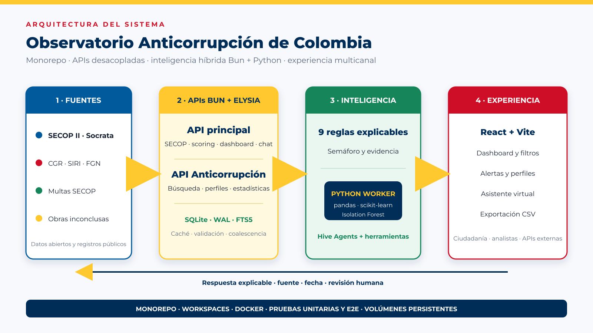

# Informe técnico de la solución

## Observatorio Anticorrupción de Colombia

**Reto 7 — Innovación y Tecnología:** diseñar asistentes virtuales que faciliten el acceso ciudadano a datos abiertos.

**Equipo:** John Paez, desarrollo de software e inteligencia artificial; Esperanza Niño, producto y operaciones.

## Resumen ejecutivo

El Observatorio Anticorrupción de Colombia es una plataforma desplegada que integra datos abiertos de contratación pública con antecedentes institucionales, reglas de riesgo, detección de anomalías y un asistente virtual. Su propósito es facilitar la consulta y ayudar a priorizar revisiones. No determina culpabilidad ni sustituye el análisis jurídico o auditor.

La solución incluye dos productos reutilizables: una aplicación web para ciudadanos y analistas, y la API Anticorrupción Colombia, que unifica responsabilidades fiscales, antecedentes disciplinarios, sanciones penales, multas contractuales y obras inconclusas.

## Problema

Las fuentes públicas son numerosas y heterogéneas. Construir un perfil exige identificar al proveedor, consultar SECOP II, revisar registros institucionales, interpretar campos y relacionar hallazgos. El volumen contractual hace costosa la revisión manual y el lenguaje técnico limita la apropiación ciudadana.

La pregunta de trabajo es: ¿cómo transformar datos abiertos dispersos en perfiles, alertas y respuestas explicables que ayuden a decidir dónde revisar primero?

## Usuarios

- Cliente o adoptante: entidades de control y oficinas de control interno.
- Usuario directo: analistas, auditores y funcionarios de contratación.
- Beneficiario: ciudadanía, veedurías, periodistas e investigadores.
- Consumidor técnico: equipos que reutilizan la API para nuevas soluciones.

## Fuentes

La fuente principal es SECOP II — Contratos Electrónicos, `jbjy-vk9h`, publicada por Colombia Compra Eficiente en datos.gov.co. Se consulta mediante Socrata con selección de campos, filtros, agregaciones y límites.

La API propia integra:

- Responsabilidades fiscales de la Contraloría.
- Antecedentes disciplinarios SIRI de Procuraduría.
- Sanciones penales de Fiscalía.
- Multas de contratos SECOP.
- Obras inconclusas o mal ejecutadas.

## API Anticorrupción Colombia

La API usa Bun, Elysia, SQLite y Swagger. Carga los archivos institucionales de manera transaccional y evita duplicar la carga cuando las tablas ya contienen datos.

Rutas principales:

- `/search`: consulta simultánea de los cinco dominios.
- `/persona/:documento`: perfil integral y resumen booleano.
- `/stats`: totales y valores consolidados.
- `/stats/departamentos`, `/stats/tipos-sancion`, `/stats/delitos`.
- Rutas especializadas por dominio.
- `/swagger`: documentación interactiva.

Esta API desacopla la aplicación de los detalles de cada fuente y puede ser consumida por entidades o productos diferentes al dashboard.

## Preparación de datos

El pipeline normaliza documentos, textos, fechas y valores. Se conservan los registros originales contractuales como JSON para trazabilidad. SQLite contiene índices por NIT, sector, nivel de riesgo y búsqueda de texto completo.

Los errores de parseo se manejan con conversiones seguras. Los archivos con estructuras atípicas se procesan con un parser tolerante y lotes transaccionales.

## Scoring explicable

El score combina nueve banderas:

1. Contratos vencidos sin cerrar: hasta 75 puntos, según el porcentaje de contratos afectados.
2. Extensión superior a un año: hasta 20, por porcentaje de contratos afectados.
3. Múltiples adiciones: hasta 15, si afectan al menos el 30 % de los contratos.
4. Concentración en cinco o más entidades: 10, si cubren al menos el 40 % de los contratos.
5. Baja ejecución: hasta 15, por porcentaje de contratos terminados afectados.
6. Antecedente disciplinario: 30.
7. Responsabilidad fiscal: 25.
8. Multa SECOP: 15.
9. Anomalía estadística: hasta 30.

Las banderas de contratos puntúan por proporción y no por cantidad, con un mínimo para activarse y un suavizado para historiales cortos (detalle en el diccionario de datos). Así un contratista con muchos contratos no acumula riesgo solo por su volumen. Los antecedentes se cruzan por documento exacto, con o sin dígito de verificación del NIT.

El semáforo es verde por debajo de 30, amarillo entre 30 y 60 y rojo por encima de 60. Cada resultado expone la lista de causas para que el usuario pueda reconstruir el puntaje.

## Isolation Forest

El modelo no supervisado compara cada NIT con sus pares del mismo sector. Juzga conducta y no tamaño: utiliza cinco características (porcentaje de contratos vencidos, de baja ejecución y con adiciones, días máximos adicionados y valor medio por contrato), con tasas suavizadas para historiales cortos, normalización estándar, 200 árboles, contaminación automática y semilla 42. Un `decision_function` menor a `-0,05` genera una bandera y un bono lineal limitado a 30 puntos, pero solo si el contratista está por encima del promedio de su sector en las variables de conducta: ser atípico por tener menos vencidos o adiciones que sus pares no es un riesgo. Se requieren al menos 10 contratistas por sector.

En una prueba controlada (30 contratistas sanos de tamaños muy distintos y 2 anómalos, 20 repeticiones), la versión anterior marcaba como anómalo al 24 % de los contratistas con 5 contratos o menos solo por su tamaño; la actual lo reduce al 6 %. Ambas detectan el 100 % de los anómalos sintéticos. La cantidad total de falsos positivos no cambia (cerca de 1 por cada 30 sanos): es el piso esperable de un detector no supervisado.

No se reporta precisión supervisada porque no existe una etiqueta completa y confiable de corrupción. Se valida la estabilidad del proceso, la escritura de resultados, la coherencia del score y la trazabilidad.

## Asistente virtual

Hive Agents coordina herramientas internas para buscar contratistas, consultar scores, listar riesgos por sector y revisar sanciones. El agente recibe una instrucción explícita: los scores son indicativos y debe citar SECOP II, SIRI, CGR, multas o la fuente correspondiente.

El historial se persiste por hilo y canal. La arquitectura admite web, Telegram y otros canales configurables.

## Arquitectura

El monorepo contiene frontend, API principal, API Anticorrupción y runtime de agentes. Bun workspaces mantiene paquetes internos y un flujo de pruebas común.

La API principal usa Bun/Elysia para atender I/O, validación y orquestación. Python se invoca como proceso especializado para pandas y scikit-learn. El frontend usa React/Vite y se sirve con Nginx. Docker Compose conecta servicios y monta volúmenes persistentes.

## Rendimiento y grandes consultas

El diseño no depende de una única optimización. Combina:

- Selección de campos y agregación en Socrata.
- Límites y paginación.
- Concurrencia controlada en grupos de cinco NIT.
- Caché en memoria y SQLite.
- Stale-while-revalidate.
- Coalescencia de peticiones concurrentes.
- Warmup por sectores.
- Timeout Socrata de 300 segundos para agregaciones grandes.

Estas medidas permiten trabajar con fuentes voluminosas sin prometer solicitudes ilimitadas. El siguiente nivel de escala requiere base compartida, caché distribuida y colas.

## Seguridad

Los controles implementados incluyen esquemas de consulta, límites, consultas parametrizadas a SQLite, secretos por entorno, red de contenedores, HTTPS y cabeceras del proxy. La seguridad no proviene automáticamente de Bun o Elysia: depende de configuración, revisión y operación.

Pendientes recomendados:

- Restringir CORS.
- Autenticar rutas administrativas.
- Incorporar rate limiting.
- Registrar auditoría y métricas.
- Analizar imágenes y dependencias.
- Rotar secretos.

## Resiliencia

Cuando Socrata falla después de existir una copia local, la API sirve la última respuesta persistida y registra que está degradada. Los errores del trabajador Python no detienen el servidor. SQLite opera en WAL y los volúmenes conservan datos entre reinicios.

## Validación

La suite cubre aritmética de banderas, semáforo, caché, persistencia, contrato de datos con la UI, API Anticorrupción e historial de chat. La auditoría E2E consulta datos reales, valida suma de puntajes, caché, modelo ML y propagación de sanciones.

## Resultados

- Aplicación pública y contenedores Docker.
- API unificada con Swagger.
- Nueve banderas explicables.
- Modelo de anomalías por sector.
- Alertas, perfiles, exportación CSV y asistente.
- Caché persistente y degradación controlada.
- Presentación y paquete documental reproducible.

Las cifras mostradas en la sustentación corresponden a una captura fechada y deben actualizarse antes de cada presentación.

## Impacto y escalabilidad

El impacto social consiste en reducir la barrera técnica. El impacto operativo consiste en focalizar revisiones. El valor técnico está en exponer una API reutilizable.

Ruta de escala:

1. Automatizar cargas institucionales.
2. Mover caché a Redis.
3. Migrar perfiles a PostgreSQL y analítica a ClickHouse.
4. Ejecutar ML mediante cola de trabajos.
5. Replicar APIs detrás de balanceador.
6. Añadir observabilidad y gobierno de datos.

## Conclusión

El Observatorio convierte datos abiertos dispersos en una experiencia verificable. Su principal fortaleza no es una predicción aislada, sino la combinación de integración, reglas comprensibles, anomalías, API y conversación con revisión humana.
